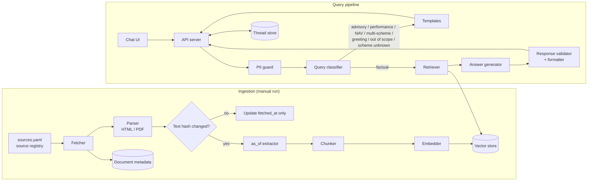

# Architecture: Mutual Fund FAQ Assistant

This document describes how the facts-only FAQ assistant defined in [problemStatement.md](problemStatement.md) is built. Requirements, scope, and the decisions log live there; this file covers components, data flow, and technology choices.

## 1. Design Principles

1. **Accuracy over intelligence.** The model only phrases answers from retrieved official text. It never answers from its own knowledge.
2. **Deterministic compliance.** Anything with a hard rule is enforced in code, not by the prompt: the citation link, the footer date, refusal wording, PII handling, and the 3-sentence limit.
3. **Refuse early.** Advisory, performance, and PII queries are caught before retrieval and answered from fixed templates.
4. **Official sources only.** The retriever can only return chunks from an allow-list of HDFC Mutual Fund, AMFI, and SEBI documents. Groww pages are saved only as raw reference snapshots and never indexed or cited.

## 2. System Overview

The system has two parts: an **offline ingestion pipeline** that builds the corpus, and an **online query pipeline** that answers questions inside chat threads.



## 3. Ingestion Pipeline (Offline)

Run by hand with a single script (`python -m ingest`). Scheduled refresh is out of scope for now (see [problemStatement.md](problemStatement.md#source-freshness)).

### 3.1 Source registry

[`data/sources.yaml`](../data/sources.yaml) is the single list of everything the bot is allowed to cite. Every entry is an official URL; Groww URLs appear only as a reference field for each scheme, never as a source. It is loaded and validated by `app/registry.py`.

Each run also saves a snapshot of every scheme's Groww page as `data/raw/<scheme id>-groww.html` (decision 1: product context). Snapshots are raw files only: never parsed, chunked, embedded, or cited, and a failed snapshot doesn't fail the run.

```yaml
schemes:
  - id: hdfc-mid-cap
    name: HDFC Mid Cap Fund – Direct Growth
    aliases: [HDFC Mid-Cap Opportunities Fund, HDFC Midcap, ...]   # former names from the SID; used by classifier and chunker
    groww_reference: https://groww.in/mutual-funds/hdfc-mid-cap-fund-direct-growth  # context only, never fetched
    sources:
      - {type: scheme_page, url: https://www.hdfcfund.com/explore/mutual-funds/hdfc-mid-cap-fund/direct, fetch: manual}
      - {type: sid,         url: https://files.hdfcfund.com/.../SID - HDFC Mid Cap Fund ....pdf, fetch: auto}
      - {type: kim,         url: https://files.hdfcfund.com/.../KIM - HDFC Mid Cap Fund ....pdf, fetch: auto}
      - {type: fund_facts,  url: https://files.hdfcfund.com/.../Fund Facts - HDFC Mid Cap Fund.pdf, fetch: auto}  # monthly, one scheme
  # ...one entry per scheme in problemStatement.md

general:            # not tied to one scheme
  - {id: hdfc-factsheet, type: factsheet, url: .../HDFC MF Factsheet - September 2026.pdf, fetch: auto, multi_scheme: true}
  - {id: hdfc-sai, type: sai, url: .../SAI with updated Addendum dated September 30, 2026.pdf, fetch: auto}  # minimum SIP for all schemes
  - {id: hdfc-request-statement, type: amc_service, url: https://www.hdfcfund.com/services/..., fetch: manual}
  - {id: amfi-categorization, type: amfi_education, url: https://www.amfiindia.com/investor/..., fetch: auto}
  - {id: sebi-riskometer, type: sebi_education, url: https://investor.sebi.gov.in/riskometer.html, fetch: auto}
  - {id: sebi-secure-account, type: investor_safety, url: https://investor.sebi.gov.in/secure_ur_inv_account.html, fetch: auto}
  # ...
```

**`fetch` modes.** `www.hdfcfund.com` returns 403 to automated clients, while the PDFs on `files.hdfcfund.com` download normally. So:

- `auto`: downloaded by the pipeline (all PDFs, AMFI and SEBI pages).
- `manual`: a person saves the page from a browser as `data/raw/manual/<source id>.html`; the pipeline ingests it from disk and reports `needs_manual` until it's there. Used for the statement/capital-gains pages. Minimum SIP amounts come from the SAI, which downloads normally.
- `none`: citation link only. Used for the HDFC scheme pages (linked from the NAV and "not found" replies). They are the only text source for the riskometer level, which every PDF draws as an image; riskometer answers are deferred (problemStatement Decisions Log #22).

**Monthly documents.** Fund Facts (one per scheme) and the combined factsheet are published at a new URL each month, so their registry URLs are updated by hand when HDFC publishes the next month's files. HDFC Silver ETF Fund of Fund has no Fund Facts; its monthly facts come from the combined factsheet.

The fetcher refuses any URL whose host is not on the allow-list (`www.hdfcfund.com`, `files.hdfcfund.com`, `www.amfiindia.com`, `investor.sebi.gov.in`, `www.sebi.gov.in`), checked on the final URL after redirects.

### 3.2 Steps

| Step | What it does |
|---|---|
| **Fetch** | Downloads each `auto` registry URL (3 attempts with backoff; 4xx fails at once), or reads the saved file for `manual` sources. Records `fetched_at` (for manual files, the file's save time). |
| **Parse** | HTML: main-content extraction (trafilatura, BeautifulSoup fallback). PDF: pdfplumber in **text-flow mode**, page by page, keeping page numbers. Text-flow follows the PDF's reading order, which keeps the factsheet's two-column layout intact (default extraction interleaves the expense-ratio block with the holdings table). File type is detected from the bytes, not the server's header. Too little text (scanned PDF, JavaScript-only page) is a parse failure. |
| **Hash** | SHA-256 of the **parsed main text** (not raw bytes, so timestamps or banners on HTML pages don't count as changes). If it matches the stored hash, only `fetched_at` is updated and the document is skipped. |
| **Extract `as_of`** | Finds the document's own date ("as on …", "effective from …") with patterns per document type. Left empty if none is found. |
| **Chunk** | Builds chunks from whole lines (so table rows are never split), **~200 words with 30-word overlap and a hard cap of 480 tokens** counted with the embedding model's own tokenizer (bge reads at most 512; the corpus averages ~1.5 tokens per word), breaking early at heading lines (ALL-CAPS titles and numbered/roman-numeral section titles such as "11. Minimum Application Amount"). A line longer than the cap is split by words. For the combined factsheet, one extra **fact card** per scheme lists its expense ratio, benchmark, exit load and lock-in on labelled lines, copied verbatim (fields whose value is missing from the text are left out). `CHUNKER_VERSION` is stored per document, so a chunking change re-chunks on the next run. See [data_research.md](data_research.md). Each chunk starts with a context line (`[document | scheme | page N]`) so the scheme name is in every embedding. In the multi-scheme factsheet, a page belongs to a scheme when one of its first lines is exactly that scheme's name or alias; pages for other HDFC schemes and shared annexures are dropped. |
| **Embed** | Embeds each chunk and inserts the new chunks into the vector store **before** deleting the document's old ones. The manifest record (hash, dates) is updated last, so a failure at any step leaves the previous version intact and the run can be repeated safely. Parsed text is also written to `data/clean/<source id>.json` (pages with numbers, hash, `as_of`). |

### 3.3 Data model

**Document** (one record per registry source in `data/manifest.json`, written atomically; the file also lists the Groww snapshots under `references`):

| Field | Notes |
|---|---|
| `doc_id` | The registry source id (e.g. `hdfc-mid-cap-kim`). Stays the same when a monthly document moves to a new URL, so the new month is treated as a content change, not a new document |
| `url` | The citation link shown to users |
| `source_type` | `scheme_page`, `sid`, `kim`, `fund_facts`, `factsheet`, `sai`, `amfi_education`, `sebi_education`, `amc_service`, `investor_safety` |
| `scheme_id` | Null for general sources |
| `title` | Shown in debugging / admin views |
| `content_hash` | SHA-256 of the parsed text, for change detection |
| `fetched_at` | Last download time (UTC) |
| `as_of` | Date stated in the document, nullable |
| `chunk_count`, `embedding_model`, `updated_at` | Consistency checks and auditing |

**Chunk** (Chroma record, `data/index`): id `<doc_id>:<version>:<index>` where `version` is the first 12 characters of the content hash, `text`, `embedding`, plus metadata `doc_id`, `version`, `chunk_index`, `scheme_id`, `source_type`, `url`, `title`, `as_of`, `fetched_at`, `page`. Chroma can't store nulls, so a missing `scheme_id`/`as_of` is `""` and a missing page is `0`. The collection records its embedding model; opening it with a different model is an error until ingestion is re-run with `--rebuild`.

## 4. Query Pipeline (Online)

Each user message goes through the stages below. Stages 1–2 can end the request early with a templated reply.

### 4.1 PII guard (rule-based, before any model call)

Regex checks on the raw message for:

- PAN (`[A-Z]{5}[0-9]{4}[A-Z]`)
- Aadhaar (12 digits, optionally spaced in groups of 4)
- Email addresses
- Indian mobile numbers (10 digits starting 6–9, optional `+91`)
- OTP-like codes (4–8 digits next to "OTP", "one-time password", "verification code" or "PIN"; a bare number such as an AMFI scheme code is not blocked)
- Bank/folio account numbers (long digit runs, 9–18 digits)

On a match, the message is **not** sent to the model, **not** embedded, and **not** stored. The thread stores the placeholder `[message removed: contained personal information]`, and the user gets the PII template asking them not to share personal details, linking the `investor_safety` source.

### 4.2 Query classifier

One LLM call with structured output returns:

```json
{
  "intent": "factual | advisory | performance | nav | multi_scheme | greeting | out_of_scope",
  "scheme_id": "hdfc-mid-cap | ... | null",
  "needs_scheme": "true if the question is about a specific scheme but none could be identified",
  "advisory_aside": "true if a factual question also contains an advisory part",
  "standalone_query": "question rewritten to make sense without the thread history"
}
```

- The last few turns of the **current thread only** are passed in, so follow-ups like "what about its exit load?" resolve to the right scheme.
- The prompt lists each scheme's name and `aliases` from the registry, so former names and abbreviations resolve.
- `scheme_id` must be one of the registry IDs or null (enforced by the output schema).

| Intent | Example | Handling |
|---|---|---|
| `factual` | "What is the exit load of HDFC Small Cap?" | Continue to retrieval (but see `needs_scheme` below) |
| `advisory` | "Should I invest in this fund?", "Which is better?" | Advisory refusal template + AMFI/SEBI education link |
| `performance` | "What were the 3-year returns?" | Template with link to the scheme's latest official factsheet; no numbers |
| `nav` | "What is today's NAV?" | Live lookup in AMFI's daily NAV file by the scheme's `amfi_code` (`app/nav.py`, cached ~1 hour, last good copy kept if a refresh fails); reply built in code with the AMFI link and the NAV date as footer. Past or changing NAV wording is re-routed to `performance` in code |
| `multi_scheme` | "Which has a lower expense ratio, Mid Cap or Small Cap?", "Exit load of all six funds?" | Template asking the user to ask about one scheme at a time, listing the scheme names; no rankings |
| `greeting` | "Hi", "Thanks" | Welcome template stating what the bot covers |
| `out_of_scope` | Other AMCs, HDFC schemes not in the corpus, stocks, questions about Groww | Template naming the 6 covered schemes |

**Flags on factual questions:**

- `needs_scheme = true`: return the **clarification template** ("Which scheme do you mean?" plus the 6 names) instead of searching. Unfiltered search is not used for scheme-specific questions, because wording like exit-load text is often identical across schemes and the wrong scheme's document could be cited.
- `advisory_aside = true`: answer the factual part as normal, limited to **2 sentences**, and the formatter appends the fixed sentence "I can't advise on whether to invest; I share facts only." This keeps the reply within 3 sentences and one link.

### 4.3 Retriever

Implemented in `app/retriever.py` (`python -m app.retriever "question" --scheme <id>`); design and measurements in [data_research.md](data_research.md).

- **Candidates:** if `scheme_id` is set, that scheme's chunks plus general sources; if `scheme_id` is null (scheme-independent questions only, e.g. "What is an expense ratio?"), general sources only.
- **Hybrid search** over the candidates:
  - dense: embeds `standalone_query` and searches Chroma with the same metadata filter
  - BM25: keyword search over the same chunks, in memory, rebuilt from the index at startup
  - the two rankings (top 50 each) are merged with reciprocal rank fusion (RRF, k = 60)
- Returns the top 8 chunks (`RETRIEVAL_TOP_K`) with their metadata, fused score and dense cosine similarity. 8 rather than 5 because two minimum-investment answers sit at ranks 6–7; with 5 the generator answered "not found" for them (Phase 2 eval).
- **Optional reranker** (`RERANKER_MODEL`, off by default): a cross-encoder reorders the fused top 20. `bge-reranker-v2-m3` gave the best accuracy but takes ~11 s per question on CPU.
- **No blanket source-type boost.** Boosting factsheet/scheme-page chunks for every question buried answers that live in the KIM and SAI (top-5 hit rate fell from 96% to 67%). The need it addressed, the latest monthly figure winning, is covered by fact cards. Genuine conflicts between documents are resolved after retrieval (`app/conflicts.py`): when the question asks about expense ratio, AUM, NAV or portfolio turnover, scheme chunks that state that figure but are older than the newest such chunk are dropped before generation.
- Measured on the 45 answerable eval questions: right chunk in the top 5 for 93% and in the top 8 for all 45, median 14 ms (see `python -m tests.retrieval_eval` and data_research.md §8). (Phase 1 reported 96%; a Phase 6 grader fix showed 5 minimum-SIP hits had matched an unrelated chunk.)
- If the best similarity score is below `MIN_SIMILARITY` (0.65), skip generation and return the "not found in official sources" template. Phase 6 tuning kept 0.65: the lowest answerable question scores 0.739. Off-topic questions about other AMCs score up to 0.805, so no threshold separates them; the classifier and the numeric-grounding check handle those.

### 4.4 Answer generator

One LLM call. The system prompt states the rules (answer only from the provided excerpts, no advice, no comparisons, no return figures, at most 3 sentences or 2 when `advisory_aside` is set, no links in the text, copy figures exactly as written with their units, name the plan a figure belongs to and default to Direct). Each excerpt is labelled with its `chunk_id`.

The model returns structured output:

```json
{
  "answerable": true,
  "answer": "plain text, no URLs",
  "source_chunk_id": "the single chunk the answer relies on"
}
```

The model **does not write the link or the footer.** Both come from the metadata of `source_chunk_id`, so the URL is always a real registry URL and the date is always the stored date.

If `answerable` is false, the "not found in official sources" template is returned with a link to the scheme's official page.

### 4.5 Response validator and formatter

Code checks on the generator output before anything reaches the user:

| Check | On failure |
|---|---|
| `source_chunk_id` is one of the retrieved chunks | Fall back to "not found" template |
| `answer` is not empty | Fall back to "not found" template |
| No URLs or bare domains in `answer` | Strip them |
| At most 3 sentences (2 with `advisory_aside`); abbreviations like "Rs.", "e.g.", "No." and decimals are not sentence breaks | Regenerate once with a reminder; if still too long, fall back to "not found" template |
| **Numeric grounding:** every number and date in `answer` appears in the cited chunk's text | Fall back to "not found" template |
| **No return figures:** no return-like content ("CAGR", "% return", "1Y/3Y/5Y", "since inception") | Regenerate once; then fall back to the performance template |
| No advisory phrasing aimed at the user (e.g. "you should", "I recommend", "better option"); quoted official text such as "investors should note" is allowed | Regenerate once; then fall back to the advisory refusal template |

At most one retry per check, so a message costs at most 3 model calls (classifier, generator, one regeneration).

The formatter then assembles the final message:

```
<answer, max 3 sentences, including the advisory aside if any>

Source: <url of source chunk>
Last updated from sources: <as_of, else fetched_at>
```

Dates are stored in UTC and displayed as an IST date in one fixed format (e.g. `27 Oct 2026`).

### 4.6 Templated responses

Refusals and fallbacks are fixed text (not model-generated), so they are always polite, consistent, and carry exactly one link:

| Template | Used for | Link |
|---|---|---|
| Advisory refusal | `advisory` intent; failed advisory check | AMFI or SEBI investor-education page (from `general` in the registry) |
| Performance query | `performance` intent; failed return-figure check | The scheme's latest official factsheet |
| NAV value | `nav` intent, Direct Growth, feed available | AMFI daily NAV file; footer is the NAV date |
| NAV unavailable | `nav` intent, Regular/IDCW plan asked, or feed down | The scheme's official HDFC MF page; no figure |
| Multi-scheme | `multi_scheme` intent | AMFI investor-education page |
| Clarification | `needs_scheme` flag | AMFI investor-education page |
| Greeting | `greeting` intent | AMFI investor-education page |
| Out of scope | `out_of_scope` intent | AMFI investor-education page |
| Not found in sources | No answer in the corpus; failed checks | The scheme's official HDFC MF page, or AMFI if no scheme was identified |
| PII detected | PII guard match | `investor_safety` page (SEBI/AMFI guidance on protecting personal information) |
| Service unavailable | Model/embedding API errors; empty corpus | None (error state, not an answer) |

Each template except "Service unavailable" ends with the `Last updated from sources` footer, using the date of the linked document.

## 5. Multi-Thread Chat

- Every conversation is a **thread** with its own `thread_id` (UUID). The UI shows a thread list; users can start, switch between, and delete threads.
- The API is stateless per request: the client sends `thread_id` + message, the server loads that thread's history from the store.
- History is used only by the classifier to rewrite follow-up questions. Retrieval and generation work on the standalone query, so one thread's content never leaks into another.
- The server is async, so requests from different threads run concurrently.
- **Per-thread lock:** messages within one thread are processed one at a time, so a second message (double click, second tab) sees the first one's answer in its history. The user message and its answer are saved in one transaction.
- **Thread privacy without accounts:** the browser generates an anonymous client ID (random UUID, kept in localStorage) and sends it with every request. Threads are stored and listed per client ID, so users sharing the server can't see each other's threads. The ID is not linked to any personal data.
- SQLite runs in WAL mode so concurrent reads and writes don't hit "database is locked".

**Thread store (SQLite):**

| Table | Fields |
|---|---|
| `threads` | `thread_id`, `client_id`, `title` (first question, truncated; "New chat" if the first message was PII-blocked), `created_at`, `updated_at` |
| `messages` | `message_id`, `thread_id`, `role`, `content` (PII-free), `source_url`, `source_date`, `created_at` |

## 6. API

| Method | Path | Purpose |
|---|---|---|
| `POST` | `/threads` | Create a thread, returns `thread_id` |
| `GET` | `/threads` | List threads |
| `GET` | `/threads/{id}/messages` | Thread history |
| `DELETE` | `/threads/{id}` | Delete a thread and its messages |
| `POST` | `/threads/{id}/messages` | Send a question, returns the formatted answer |
| `GET` | `/health` | Liveness, corpus document count, latest `fetched_at` |

- Every thread endpoint requires an `X-Client-Id` header and only sees that client's threads; another client's `thread_id` returns 404.
- `POST /threads/{id}/messages` rejects empty messages and messages over 1,000 characters (422).
- **Rate limit:** 20 messages per minute per client ID (429 with a friendly message), to control cost and abuse.

## 7. User Interface

A single static page served by the API server (no build step):

- Left sidebar: thread list and "New chat" button
- Main panel: welcome message and three clickable example questions on an empty thread, e.g.
  - "What is the expense ratio of HDFC Mid Cap Fund – Direct Growth?"
  - "What is the lock-in period for HDFC ELSS Tax Saver Fund?"
  - "How do I download my capital gains statement?"
- Persistent disclaimer banner: **"Facts-only. No investment advice."**
- Each answer shows the source link as a clickable link and the footer date.
- On first load, generates and stores the anonymous client ID in localStorage, and sends it on every request.
- Sending is disabled in a thread while its answer is pending; other threads stay usable.

## 8. Technology Stack

| Concern | Choice | Why |
|---|---|---|
| Language | Python 3.12 | Mature RAG and PDF tooling |
| API server | FastAPI + Uvicorn | Async, so threads are served concurrently; also serves the static UI |
| LLM | Groq via the `groq` Python SDK (Chat Completions API), `temperature` 0. Classifier: `openai/gpt-oss-20b`; generator: `openai/gpt-oss-120b` | Both models support Groq's strict structured outputs (`response_format` with `json_schema`, `strict: true`), so classifier and generator always return schema-valid JSON. The smaller model keeps classification fast; the larger one handles answer extraction. Temperature 0 keeps answers repeatable. |
| Embeddings | Default: `BAAI/bge-small-en-v1.5` (384 dimensions) run locally via `fastembed` (ONNX), cached in `.cache/fastembed/`. Optional: Voyage AI `voyage-4` (1024 dimensions) with `EMBEDDING_PROVIDER=voyage` | Groq has no embeddings endpoint. The local model needs no API key or network calls at query time and is good enough for a corpus this small; Voyage stays available if retrieval quality needs a boost in Phase 6 (switching requires `python -m ingest --rebuild`) |
| Vector store | Chroma (local, persistent) in `data/index/` | No separate server; supports metadata filters; ~5 ms filtered queries at this scale. BM25 keyword search runs in-process over the same chunks (Chroma has no local BM25) |
| Reranker | None by default; optional fastembed cross-encoder via `RERANKER_MODEL` | Best tested (`bge-reranker-v2-m3`) is too slow on CPU for the 5 s response target |
| Document metadata | `data/manifest.json`, written atomically | Small (one record per document), diffable, committed with the registry |
| Threads | SQLite (WAL) in `data/threads.db` | Single file, no setup |
| HTML parsing | trafilatura / BeautifulSoup | Main-content extraction from AMC, AMFI, SEBI pages |
| PDF parsing | pdfplumber | Keeps table rows and page numbers for SID/KIM/factsheets |
| Frontend | Plain HTML + JS | Minimal UI requirement; no build tooling |

**Configuration (environment variables):** `GROQ_API_KEY`, `VOYAGE_API_KEY`, `CLASSIFIER_MODEL` (default `openai/gpt-oss-20b`), `GENERATOR_MODEL` (default `openai/gpt-oss-120b`), `EMBEDDING_PROVIDER` (default `local`), `EMBEDDING_MODEL` (default per provider), `DATA_DIR`, `SOURCES_PATH`, `RETRIEVAL_TOP_K` (default 8), `MIN_SIMILARITY` (default 0.65, kept after Phase 6 tuning; see §4.3), `RERANKER_MODEL` (default off). Groq calls use `reasoning_effort: low` with reasoning text excluded from the reply.

**Groq constraints to design around:**

- Structured outputs can't be combined with streaming or tool use on Groq, so classifier and generator calls are non-streaming, single-shot requests. Answers are short, so this costs little latency.
- If a configured model doesn't support strict `json_schema`, the app refuses to start rather than falling back to unvalidated JSON.
- Groq applies per-account rate limits (requests and tokens per minute). The app's own per-client limit (section 6) sits below them, and a Groq 429 returns the "Service unavailable" template.

## 9. Project Layout

```
RAG-Bot/
├── Docs/                     # problemStatement, architecture, implementation_plan, edge_case, eval
├── README.md
├── data/
│   ├── sources.yaml          # source registry (official URLs only)        [committed]
│   ├── manifest.json         # one record per ingested document + Groww snapshots [committed]
│   ├── raw/                  # downloads, raw/manual/ saves, <scheme>-groww.html snapshots [ignored]
│   ├── clean/                # parsed text per document (<source id>.json)  [ignored]
│   └── index/                # Chroma vector index                          [ignored]
├── ingest/                   # offline pipeline (python -m ingest)
│   ├── fetch.py              # downloads + manual files, allow-list, retries, Groww snapshots
│   ├── parse.py              # PDF (text flow) / HTML text extraction
│   ├── dates.py              # as_of extraction
│   ├── chunk.py              # chunking (200 words, 480-token cap) + multi-scheme page tagging
│   ├── factcards.py          # per-scheme fact cards from the combined factsheet
│   ├── embed.py              # local bge-small / Voyage embedders (+ fake for tests)
│   ├── store.py              # Chroma chunk store
│   ├── manifest.py           # data/manifest.json read/write (atomic)
│   ├── pipeline.py           # run order and failure handling
│   └── inspect.py            # python -m ingest.inspect <scheme_id>
├── app/
│   ├── config.py             # settings + domain allow-list
│   ├── registry.py           # loads and validates sources.yaml
│   ├── llm.py                # Groq client wrapper (strict JSON-schema calls, error mapping)
│   ├── smoke.py              # python -m app.smoke: live Groq + embedding check
│   ├── main.py               # FastAPI app + routes, serves web/
│   ├── pipeline.py           # PII guard → classifier → template | NAV | answer path
│   ├── ask.py                # answer path (retrieve → generate → validate) + CLI: python -m app.ask
│   ├── conflicts.py          # most-recent-as_of rule for changing figures
│   ├── nav.py                # live NAV lookup in AMFI's daily file
│   ├── pii_guard.py
│   ├── classifier.py
│   ├── retriever.py          # hybrid search: Chroma dense + BM25, RRF, optional reranker
│   ├── generator.py
│   ├── validator.py          # checks + formatter (link, footer)
│   ├── templates.py          # refusal / fallback text
│   └── threads.py            # thread store
├── web/                      # static UI
├── .cache/fastembed/         # downloaded local embedding model (git-ignored)
└── tests/
    ├── gold_facts.yaml       # official values per fact, with source document and hash
    ├── eval_questions.yaml   # factual + advisory + PII test set
    ├── fact_recall.py        # python -m tests.fact_recall: chunk-level fact recall
    ├── retrieval_eval.py     # python -m tests.retrieval_eval: hit@k / MRR on the real index
    ├── answer_eval.py        # Phase 2: answer path only
    ├── pipeline_eval.py      # Phase 3: full pipeline, template grading
    ├── run_eval.py           # Phase 6: every question, targets report, cache + pacing, --tune
    ├── followup_eval.py      # live follow-up check across two threads via the API
    └── results/              # saved eval reports
research/                     # data research scripts (Docs/data_research.md)
```

## 10. Testing and Evaluation

A fixed question set (`tests/eval_questions.yaml`) covering each requirement, run against the full pipeline:

| Category | Checks |
|---|---|
| Factual (each scheme × each fact type) | Answer matches the official value; link is the correct document |
| Advisory | Refused, with an AMFI/SEBI link |
| Performance / NAV fallback | No numbers; factsheet or scheme page link only (a NAV value comes only from the AMFI file, never from the model) |
| Multi-scheme, greeting, clarification, mixed intent | Correct template; mixed intent answers the factual part plus the advisory aside |
| PII | Not sent to the model; not stored; `investor_safety` link |
| Format (all responses) | ≤ 3 sentences, exactly one link, footer present |
| Grounding | Every number/date in an answer appears in the cited chunk; no return figures |
| Multi-thread | Follow-ups resolve within a thread; no cross-thread leakage; one client can't see another's threads |

## 11. Privacy and Security

- PII is blocked before any model call, embedding, or storage (section 4.1).
- Threads are scoped to an anonymous browser client ID, so no one can list another visitor's threads (section 5).
- Application logs record intent, scheme, retrieved `chunk_id`s, and latency, but not raw user messages.
- API keys come from environment variables only and are never logged.
- User questions (already PII-checked) are sent to Groq for classification and answering. With the default local embedding model nothing else leaves the server (with `EMBEDDING_PROVIDER=voyage`, query text is also sent to Voyage AI).
- The fetcher only contacts allow-listed official domains, plus `groww.in` for the reference snapshots (which are never indexed or cited).

## 12. Known Limitations

- **Freshness depends on manual re-ingestion.** Facts are only as current as the last ingestion run.
- **Regex PII detection is not exhaustive.** Unusual formats may slip through; a message the guard misses is sent to the model and stored like any other.
- **PDF table extraction can be imperfect**, especially for multi-column factsheets, which may cause missed or misread values. Some values are drawn as graphics and have no text at all: every riskometer level, and the exit-load percentage on the Silver ETF FoF factsheet page.
- **Riskometer classification is not answered (deferred).** The level appears as text only on HDFC scheme pages, which block automated downloads; every PDF, and AMFI's riskometer disclosure page, show it as an image or an interactive form. Riskometer questions get "not found in official sources" with a link to the scheme page, where the riskometer is shown.
- **Statement / capital-gains download questions depend on two manually saved HDFC pages.** Until they're saved into `data/raw/manual/`, those questions get "not found".
- **Monthly document URLs are updated by hand.** Fund Facts and the combined factsheet move to a new URL each month.
- **Single AMC.** Questions about other AMCs are answered as out of scope.
- **Fund-manager answers may cite the older SID** (found in Phase 6). The answer names the correct current manager, but for 3 schemes it links the Nov 2025 SID instead of the Sep 2026 factsheet. Adding fund manager to the conflict rule alone made the model pick the factsheet's dedicated asset-class manager ("Gold/Silver Instruments") instead, so it also needs a generator prompt rule, not yet verified.
- **Similarity threshold can't screen off-topic fund questions.** Other AMCs' expense-ratio questions score as high as answerable ones; the classifier (out of scope) and numeric grounding are the safeguards.
- **Groq free-tier quota.** 200k tokens per model per rolling 24 hours; heavy use returns "service unavailable", and one uncached full eval run uses most of a day's generator quota.
