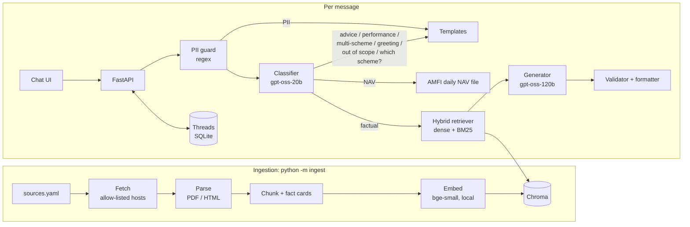

# HDFC Mutual Fund FAQ Assistant (Facts-Only)

> **Facts-only. No investment advice.**

A small retrieval-augmented (RAG) chatbot that answers factual questions about six HDFC Mutual Fund schemes, using only official HDFC Mutual Fund, AMFI and SEBI documents. Every reply is at most 3 sentences, carries exactly one source link, and ends with `Last updated from sources: <date>`. Advice, performance and personal-data questions get fixed, polite refusals. The chat page supports several independent threads at once.

Requirements are in [Docs/problemStatement.md](Docs/problemStatement.md) and the full design is in [Docs/architecture.md](Docs/architecture.md).

## Selected AMC and schemes

**AMC:** HDFC Mutual Fund.

| Scheme | Registry id |
|---|---|
| HDFC Mid Cap Fund – Direct Growth | `hdfc-mid-cap` |
| HDFC Small Cap Fund – Direct Growth | `hdfc-small-cap` |
| HDFC Large Cap Fund – Direct Growth | `hdfc-large-cap` |
| HDFC Silver ETF Fund of Fund – Direct Growth | `hdfc-silver-etf-fof` |
| HDFC Multi Cap Fund – Direct Growth | `hdfc-multi-cap` |
| HDFC ELSS Tax Saver Fund – Direct Plan Growth | `hdfc-elss-tax-saver` |

The corpus is listed in [data/sources.yaml](data/sources.yaml): each scheme's SID, KIM and monthly Fund Facts, the combined monthly factsheet, the SAI, and AMFI and SEBI investor-education pages (29 documents, about 2,700 chunks). Groww pages were used only to pick the schemes. They are saved as raw reference snapshots and are never indexed or cited.

## Setup

You need Python 3.12 and a [Groq API key](https://console.groq.com/keys). The free tier is enough to use the chat, but not for frequent full eval runs (see [Running the eval](#running-the-eval)). Embeddings run locally, so no other key is needed.

```bash
git clone <repo-url> RAG-Bot && cd RAG-Bot
python3.12 -m venv .venv
source .venv/bin/activate          # Windows: .venv\Scripts\activate
pip install -r requirements.txt

cp .env.example .env               # then set GROQ_API_KEY in .env
python -c "import app.config"      # checks that the settings load
python -m app.smoke                # optional: one live call to each Groq model + the embedder
```

### Build the corpus

```bash
python -m ingest
```

This downloads every `auto` source, parses it, chunks it and embeds it into `data/index/` (Chroma). The first run also downloads the local embedding model (`BAAI/bge-small-en-v1.5`, about 70 MB, into `.cache/fastembed/`) and takes about 10 minutes. It prints one line per document: `updated`, `unchanged`, `needs_manual` or `failed`.

Two HDFC statement pages are `fetch: manual`, because `www.hdfcfund.com` blocks automated downloads. They report `needs_manual`, and that's expected. To include them, open each URL from `sources.yaml` in a browser, save it as `data/raw/manual/<source id>.html` (`hdfc-request-statement.html`, `hdfc-capital-gain-statement.html`), and run `python -m ingest` again. Until then, statement and capital-gains questions get "not found" with a link to the official page.

Check the result:

```bash
python -m ingest.inspect hdfc-mid-cap      # list a scheme's chunks
python -m app.ask "What is the exit load of HDFC Small Cap Fund?"
```

### Start the server

```bash
uvicorn app.main:app
```

Open http://127.0.0.1:8000/. `GET /health` reports the document count and the latest fetch time. Threads are stored in `data/threads.db` (SQLite).

## Architecture overview



- **Code enforces the rules.** A regex PII guard runs before any model call, and a matching message is never sent, embedded or stored. Refusals and fallbacks are fixed templates. The generator returns `{answerable, answer, source_chunk_id}`, and code adds the link and footer date from the cited chunk's stored metadata, so the model never writes either.
- **Retrieval:** dense search (Chroma) plus in-memory BM25, filtered to the identified scheme plus general sources and merged with reciprocal rank fusion. The top 8 chunks go to the generator. For figures that change over time (expense ratio, AUM, NAV, turnover), older chunks are dropped when a newer one states the figure.
- **Validation:** the cited chunk must be one of the retrieved chunks. The checks are: at most 3 sentences, every number and date present in the cited chunk, no return figures, no advice aimed at the user, and URLs stripped. A failed check gets one regeneration, then a safe template, so a message costs at most 3 model calls.
- **Threads:** each thread passes its own recent history to the classifier, so follow-ups like "what is its exit load?" resolve within that thread only. Threads are scoped to an anonymous browser client id. Messages in one thread are processed in order, and different threads run concurrently.
- **NAV:** today's NAV for the Direct Growth option is looked up live in AMFI's daily NAV file and copied exactly. No model writes the figure.

| Layer | Choice |
|---|---|
| LLM | Groq, strict JSON-schema outputs, temperature 0: `openai/gpt-oss-20b` (classifier), `openai/gpt-oss-120b` (generator) |
| Embeddings | `BAAI/bge-small-en-v1.5` via fastembed, local (Voyage AI optional) |
| Vector store | Chroma, local, in `data/index/` |
| API + UI | FastAPI, plus a static HTML/JS page in `web/` with no build step |

Project layout: `ingest/` (offline pipeline), `app/` (query pipeline and API), `web/` (chat page), `data/` (registry, manifest, generated data), `tests/` (unit tests and eval), `Docs/` (requirements, design, plan, eval method).

## Refreshing sources

Re-fetching is manual. Run `python -m ingest` again: unchanged documents are skipped (the hash of the parsed text is compared), and changed ones are re-chunked and re-embedded. A failure leaves the previous version in place.

HDFC publishes Fund Facts and the combined factsheet at a **new URL each month**. When a new month's files appear, update those URLs in `data/sources.yaml` and run `python -m ingest`. If you change the embedding provider or model, run `python -m ingest --rebuild`.

## Running the tests and eval

```bash
pytest                       # ~270 offline tests, no network or API calls (a few seconds)
pytest --run-network         # also checks every source URL is reachable and allow-listed
pytest --run-live            # also makes live Groq calls

python -m tests.fact_recall      # each gold fact is present in some chunk (offline)
python -m tests.retrieval_eval   # hit@k / MRR on the real index (offline)
python -m tests.run_eval --tune  # MIN_SIMILARITY / TOP_K analysis (offline)
```

### Running the eval

```bash
python -m tests.run_eval                       # all 95 questions through the full pipeline
python -m tests.run_eval --categories advisory # or --ids F-MIDCAP-EXIT-LOAD-01 ...
python -m tests.followup_eval                  # live follow-up check across two threads
```

The runner writes `tests/results/<date>-phase6.{md,json}`. Model responses are cached in `data/llm_cache/` by full request, so a re-run only pays for questions whose prompt changed (`--no-cache` forces fresh calls). Calls are paced under Groq's per-minute limit, and the run stops cleanly with a partial report if a model's daily limit is hit. One uncached full run uses about 190k tokens on `gpt-oss-120b`, close to the free tier's 200k per rolling 24 hours.

**Latest full run** ([tests/results/2026-10-29-phase6.md](tests/results/2026-10-29-phase6.md)): 92 of 95 passed, and every target was met:

- Factual accuracy: 45/45 correct, 0 wrong values.
- Advisory, performance, PII and template routing: 100%.
- Format and citation: 100%.

The 3 failures are fund-manager answers that name the right person but cite the SID instead of the newer factsheet (see below).

## Known limitations

- **Freshness depends on manual re-ingestion.** Facts are as current as the last `python -m ingest` run, and the monthly document URLs are updated by hand. The footer always shows the cited source's date.
- **Riskometer level is not answered.** It's shown as text only on HDFC scheme pages, which block automated downloads, and every PDF draws it as an image. Riskometer questions get "not found" with a link to the scheme page.
- **Statement and capital-gains questions need two manually saved pages** (see [Build the corpus](#build-the-corpus)). Until they are saved, the third example question in the UI ("How do I download my capital gains statement?") gets "not found".
- **Fund-manager answers may cite the older SID.** For Mid Cap, Small Cap and Large Cap, the answer names the correct current manager but links the Nov 2025 SID rather than the Sep 2026 factsheet. Making the newest document win here also needs a generator prompt change, because the factsheet's manager table lists dedicated asset-class managers (e.g. "Gold/Silver Instruments") that the model sometimes picks instead. That change hasn't been verified yet, since it needs a full uncached eval run.
- **Regex PII detection is not exhaustive.** Unusual formats may slip through.
- **PDF extraction is imperfect.** Some values exist only as graphics (every riskometer, and the Silver ETF FoF exit-load percentage on the factsheet).
- **Live checks not yet run:** the real-model follow-up test (`python -m tests.followup_eval`; the mechanism is covered by mock API tests) and eval.md's 3-run stability check. Both were held back by Groq free-tier quota.
- **Gold facts are not human-verified.** The eval's expected values (`tests/gold_facts.yaml`, `verified: false`) were read from the documents but haven't been independently checked.
- **Free-tier Groq limits.** Under heavy use, or once the daily token quota runs out, replies fall back to "service unavailable". The app's own limit is 20 messages per minute per client, and messages are capped at 1,000 characters.
- **Single AMC.** Other AMCs, other HDFC schemes and stocks are answered as out of scope. NAV figures cover only the Direct Growth option.

## Disclaimer

**Facts-only. No investment advice.** This assistant shares facts from official documents only. It does not recommend, compare or predict the performance of any scheme. Mutual fund investments are subject to market risks; read all scheme-related documents carefully.
